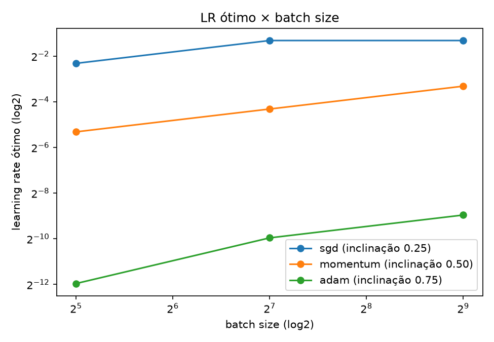

# MLP do zero em NumPy

[](https://github.com/arthurvelloso/mlp/actions/workflows/ci.yml)

Uma rede neural (Multilayer Perceptron) implementada do zero, só com NumPy, sem
PyTorch nem TensorFlow. Camadas, backprop e otimizadores (SGD, momentum, Adam,
AdamW) escritos à mão, com os gradientes conferidos por diferenças finitas.
Sobre essa base, um estudo de como o learning rate ótimo varia com o batch size.

## Resultado

**Uma MLP 784-256-128-10 escrita do zero chega a 96,5% de acurácia no teste do
MNIST.** Os gradientes foram conferidos por diferenças finitas (erro relativo
< 1e-7) e os quatro otimizadores batem passo a passo com o `torch.optim`, tudo
verificado no CI. Num estudo de 216 runs, o Adam tolerou uma faixa de learning
rates bem mais larga que o SGD (14 de 24 combinações perto do melhor, contra 6).



Relatório completo (2-3 páginas): [`research/RELATORIO.md`](research/RELATORIO.md).

| Otimizador | Acurácia de teste (3 seeds) |
| --- | --- |
| SGD | 95,92% ± 0,21 |
| SGD+momentum | **96,49% ± 0,12** |
| Adam | 96,29% ± 0,09 |

## O que já tem

Em `src/`:

- **`layers.py`**
  - `Linear` — transformação afim `y = x @ W + b`, com inicialização de He.
  - `ReLU` — ativação `max(0, x)`.
- **`losses.py`**
  - `SoftmaxCrossEntropy` — softmax e cross-entropy combinadas de forma
    numericamente estável (log-sum-exp). O gradiente na saída é
    `probabilidades − one_hot`.

Cada camada tem `forward` e `backward`, do jeito que um framework faz por dentro.
Exemplo de uma rede `Linear → ReLU → Linear → Softmax`:

```python
import numpy as np

from src.layers import Linear, ReLU
from src.losses import SoftmaxCrossEntropy

x = np.random.default_rng(0).normal(size=(32, 784))
targets = np.random.default_rng(1).integers(0, 10, size=32)

linear_1 = Linear(784, 128, seed=0)
relu = ReLU()
linear_2 = Linear(128, 10, seed=1)
loss_fn = SoftmaxCrossEntropy()

# Forward
hidden = relu.forward(linear_1.forward(x))
logits = linear_2.forward(hidden)
loss = loss_fn.forward(logits, targets)

# Backward
gradient = loss_fn.backward()
gradient = linear_2.backward(gradient)
gradient = relu.backward(gradient)
gradient = linear_1.backward(gradient)
```

## Como reproduzir

Testado em Python 3.11+.

```bash
# 1. criar e ativar o ambiente
python -m venv .venv
source .venv/bin/activate        # no Windows: .venv\Scripts\activate

# 2. instalar as dependências (versões fixas; o requirements-dev traz o
#    PyTorch, usado só nos testes dos otimizadores)
pip install -r requirements.txt -r requirements-dev.txt

# 3. rodar os testes
make test

# 4. reproduzir o estudo inteiro (216 runs, figuras, tabela e teste final)
make research
```

Comandos do `Makefile`:

| Comando | O que faz | Disponível |
| --- | --- | --- |
| `make test` | roda os testes | ✅ |
| `make lint` | verifica o estilo (ruff) | ✅ |
| `make format` | formata o código (ruff) | ✅ |
| `make gradcheck` | confere os gradientes por diferenças finitas | ✅ |
| `make train` | treina no MNIST e grava `reports/metrics.csv` | ✅ |
| `make plots` | gera as curvas a partir do CSV | ✅ |
| `make reproduce` | gradient check + treino + curvas | ✅ |
| `make compare` | compara SGD, momentum, Adam e AdamW na mesma rede | ✅ |
| `make research` | estudo de LR × batch: grade, figuras, tabela e teste final | ✅ |

O primeiro `make train` baixa o MNIST para `data/mnist.npz` (uma vez só).
Os hiperparâmetros ficam em `configs/default.yaml`. Com a mesma config e a mesma
seed, o CSV de métricas sai idêntico a cada execução.

## Decisões

Por que o projeto é do jeito que é. Decisões que não são óbvias pelo código.

- **NumPy puro:** sem framework de deep learning, de propósito. A ideia é
  implementar forward e backward na mão.
- **Softmax + cross-entropy numa classe só:** junto é numericamente estável e o
  gradiente fica simples (`probabilidades − one_hot`); separado, o cálculo pode
  estourar com logits grandes.
- **Inicialização de He na `Linear`:** adequada para redes com ReLU.
- **Split:** 50 mil treino e 10 mil validação, estratificado e com seed fixa. Os
  10 mil de teste oficiais só entram na avaliação final do estudo
  (`src.research_test`), uma vez, depois de fixar as configurações.
- **Normalização global:** média e desvio escalares, calculados só no treino.
  Por pixel não funciona no MNIST: pixels de borda quase sempre valem 0, e
  dividir pelo desvio minúsculo deles gerou entradas de até ~100 e uma loss de
  validação na casa de centenas.
- **Early stopping e checkpoint pela acurácia de validação.**

## Limitações

O que o projeto **não** garante. Seja honesto aqui.

- O treino principal (`make train`) usa uma seed e um split só. No estudo de
  otimizadores são 3 seeds, o que dá uma ideia da variação, não um intervalo de
  confiança estreito.
- Há overfitting leve no treino principal: a loss de treino vai a ~0 e a de
  validação sobe um pouco depois da época ~8. O checkpoint usa a acurácia, não
  a loss.
- O estudo de LR × batch usa um só dataset (MNIST), uma arquitetura pequena,
  grade de LR em fator 2 e 15 épocas num subconjunto de 10 mil exemplos. Por
  isso a hipótese sobre a regra de escala ficou inconclusiva (detalhes em
  [`research/RELATORIO.md`](research/RELATORIO.md)).
- Foco didático: não é otimizado para velocidade nem pensado para produção.

## Estrutura

```
.
├── src/
│   ├── layers.py   # Linear, ReLU
│   ├── losses.py   # SoftmaxCrossEntropy
│   ├── network.py  # MLP: forward e backprop da rede inteira
│   ├── gradcheck.py# gradient check por diferenças finitas
│   ├── data.py     # MNIST, split estratificado, normalização
│   ├── optim.py    # SGD, momentum, Adam, AdamW
│   ├── train.py    # loop de treino, CSV, early stopping, checkpoint
│   ├── plots.py    # curvas a partir do CSV
│   ├── compare_optimizers.py  # os otimizadores na mesma rede
│   └── research_*.py          # estudo de LR × batch: grade, figuras, teste final
├── research/       # pré-registro, resultados, figuras e relatório do estudo
├── tests/          # testes automatizados (pytest)
├── notebooks/      # exploração; o código "de verdade" mora em src/
├── configs/        # hiperparâmetros e caminhos, versionados
├── requirements.txt
├── Makefile
└── .github/workflows/ci.yml
```

## Licença

Este projeto usa a licença MIT. Veja [LICENSE](LICENSE).
