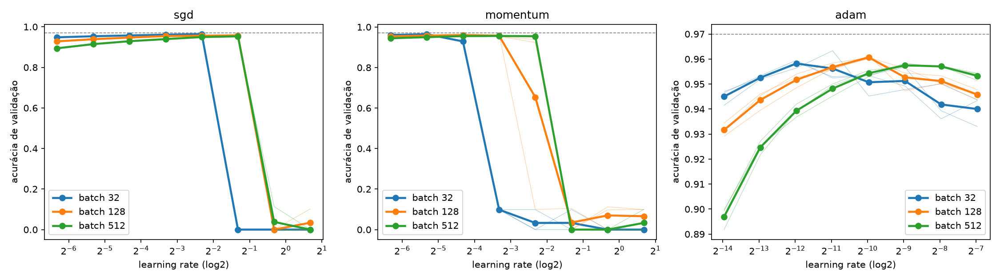
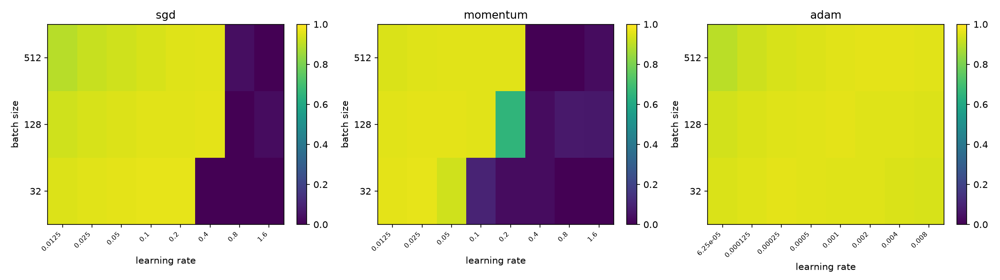
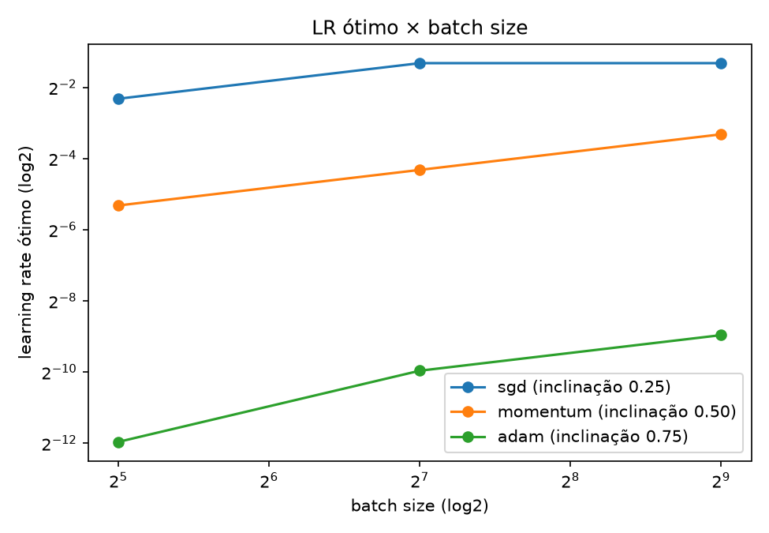

# Learning rate ótimo vs. batch size em SGD, momentum e Adam

Projeto de pesquisa independente · MNIST · otimizadores implementados do zero
em NumPy. Reproduzível com um comando (ver o fim).

## 1. Pergunta e hipóteses

As mesmas do pré-registro (`PREREGISTRO.md`), fixadas antes de rodar.

**Pergunta.** O learning rate ótimo cresce com o batch size de forma linear no
SGD, como sugerem Goyal et al. (2017), e pela raiz quadrada no Adam, como
sugerem Malladi et al. (2022)? E qual otimizador tolera uma faixa maior de
learning rates?

- **H1:** a inclinação de `log(LR ótimo)` contra `log(batch)` fica perto de **1**
  no SGD (com e sem momentum) e perto de **0,5** no Adam.
- **H2:** o Adam mantém boa acurácia numa faixa de learning rates mais larga que
  o SGD.

## 2. Setup

- **Modelo:** MLP 784-256-128-10, ReLU, softmax + cross-entropy. Camadas,
  backprop e otimizadores escritos do zero em NumPy (sem framework de deep
  learning). Os gradientes foram conferidos por diferenças finitas (erro
  relativo < 1e-7) e os otimizadores batem com o `torch.optim`, ambos no CI.
- **Dados:** MNIST. Treino de 10 mil exemplos (subconjunto, para caber no
  orçamento), 10 mil de validação (split estratificado, seed fixa). Os 10 mil de
  teste oficiais só foram usados na avaliação final da seção 3. Normalização por
  média e desvio globais do treino.
- **Grade:** 3 otimizadores × 8 learning rates (fator 2) × 3 batches
  {32, 128, 512} × 3 seeds = **216 runs**. Faixas de LR por otimizador no
  pré-registro.
- **Orçamento:** 15 épocas por run, igual para todos.
- **Hardware:** Apple M5, 10 núcleos, 16 GB. Python 3.14, NumPy 2.1.3, CPU.
  A grade inteira rodou em ~10 min.

## 3. Resultados

### Avaliação final no teste (configurações finalistas)

Finalistas: o melhor LR de cada otimizador no batch 128. Treinadas com 3 seeds e
avaliadas no teste oficial **uma única vez**.

| Otimizador | LR | Acurácia de teste (média ± desvio, 3 seeds) |
| --- | --- | --- |
| SGD | 0,4 | 95,92% ± 0,21 |
| SGD+momentum | 0,05 | **96,49% ± 0,12** |
| Adam | 0,001 | 96,29% ± 0,09 |

### Figuras

**Figura 1.** Acurácia de validação vs. learning rate, por otimizador e batch.
Média em traço grosso, seeds individuais em traço fino.



**Figura 2.** Heatmap LR × batch da acurácia média, um painel por otimizador.



**Figura 3.** LR ótimo × batch em escala log-log, com a inclinação ajustada por
mínimos quadrados.



### Tabela: inclinações e tolerância ao LR

| Otimizador | Inclinação (H1) | Combinações perto do melhor (H2, de 24) |
| --- | --- | --- |
| SGD | 0,25 | 6 |
| SGD+momentum | 0,50 | 8 |
| Adam | 0,75 | 14 |

"Perto do melhor" = acurácia média a no máximo 1 ponto percentual do melhor
resultado do próprio otimizador. Dos 216 runs, 41 divergiram, todos de SGD ou
momentum com LR alto.

## 4. Conclusões

- **H1 não se confirmou** (figura 3). As inclinações medidas (0,25 / 0,50 / 0,75)
  não batem com o esperado (~1 para SGD, ~0,5 para Adam); a ordem entre
  otimizadores sai até invertida. O experimento não detecta a regra de escala.
- **H2 se confirmou** (figuras 1 e 2). O Adam fica perto do seu melhor em 14 das
  24 combinações, contra 6 do SGD; nas curvas, SGD e momentum têm um platô curto
  e caem para o nível do acaso quando o LR passa do ponto, enquanto o Adam é um
  sino suave e não divergiu em nenhum LR da grade.
- **Melhor acurácia de teste:** momentum (96,49%), à frente de Adam e SGD, mas as
  três ficam dentro de ~0,6 ponto (tabela da seção 3).

## 5. O que não dá para concluir

- **Um só dataset e um só modelo:** MNIST com uma MLP pequena. Nada garante que
  vale para outros dados ou arquiteturas.
- **Grade grossa:** LR em passos de fator 2 e só 3 batches. O "LR ótimo" é o
  melhor da grade, não um ótimo contínuo, e a inclinação de H1 é muito sensível a
  isso. É a explicação mais provável para H1 não aparecer.
- **Orçamento curto:** 15 épocas num subconjunto de 10 mil. As regras de escala
  valem perto do ótimo e com treino mais longo; aqui o alvo absoluto de 97% nem
  foi alcançado em validação.
- **3 seeds:** dão uma ideia da variação, não um intervalo de confiança estreito.

Em resumo: H1 fica **inconclusivo** (o setup não tem resolução para testá-lo), e
não se deve lê-lo como refutação das teorias.

## 6. Como reproduzir

Testado em Python 3.11+. Depois de instalar as dependências, um comando faz
tudo: os 216 runs, as figuras, a tabela-resumo e a avaliação final no teste.

```bash
pip install -r requirements.txt
make research
```

Mesma config e mesmas seeds dão o mesmo resultado. A configuração está em
`configs/research.yaml`; o desenho e as hipóteses, em `PREREGISTRO.md`.

## Referências

- Goyal et al. (2017), "Accurate, Large Minibatch SGD". arXiv:1706.02677.
- Malladi et al. (2022), "On the SDEs and Scaling Rules for Adaptive Gradient
  Algorithms". arXiv:2205.10287.
- "The Best Optimizer Depends on Batch Size" (arXiv, out/2026).
